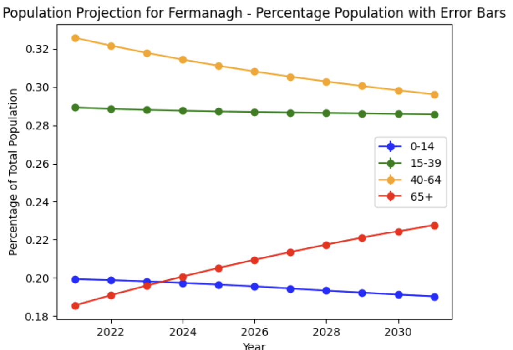
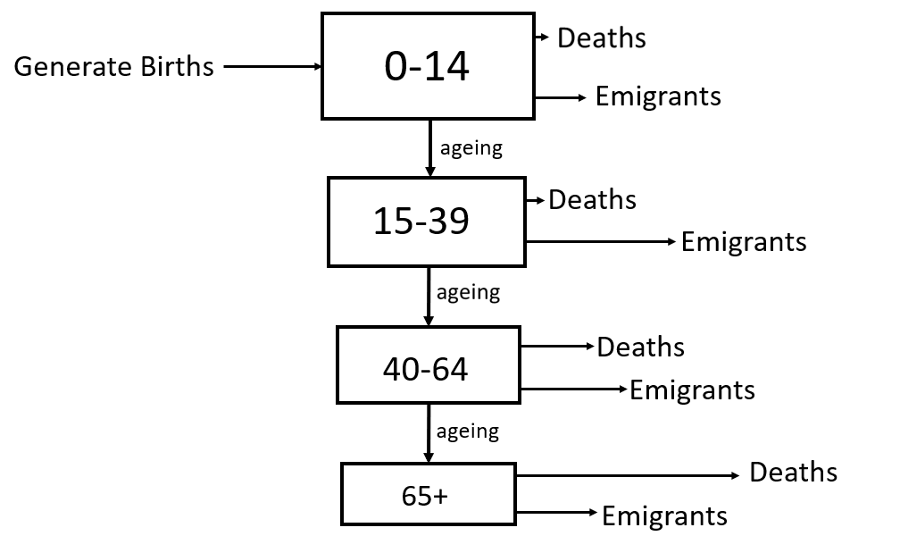
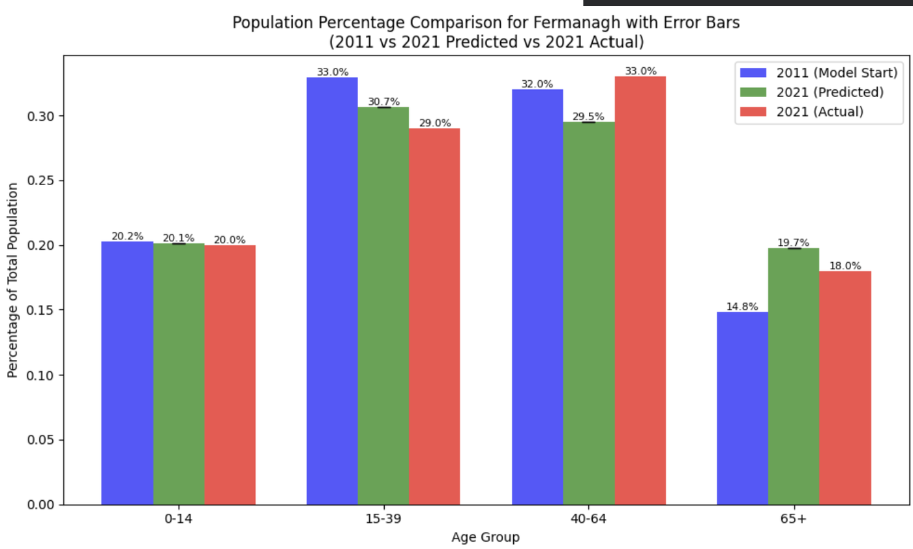

# Fermanagh population projection

A population model built for Fermanagh Community Transport (FCT), a community transport provider in Northern Ireland. It projects how many people Fermanagh will have in each age group by 2031, so FCT can plan vehicles, routes and funding around who will actually be using the service. A version of this was presented to FCT's leadership.

## What it found

The population grows a little but gets a lot older. The 65+ group grows by almost a third while the 40-64 group shrinks.

| Age group | 2021 | 2031 (projected) | Change |
|---|---|---|---|
| 0-14 | 12,717 | 12,607 | -0.9% |
| 15-39 | 18,440 | 18,907 | +2.5% |
| 40-64 | 20,983 | 19,609 | -6.5% |
| 65+ | 11,445 | 15,081 | +31.8% |
| Total | 63,585 | 66,192 | +4.1% |

People aged 65 and over go from 18% of the population to about 23%, which is more than 3,500 extra people. For FCT that means more demand for accessible, door-to-door transport. The report recommends moving toward a fully accessible fleet, expanding flexible services, training staff in assisting older passengers, and using the projections in funding applications.

## How the model works

Four age groups (0-14, 15-39, 40-64, 65+). Each year the model works out births, deaths, people ageing into the next group, and net migration.

- Births and deaths are random draws (binomial), so every run comes out a bit different. Migration is a fixed rate.
- The whole projection is run 200 times. The results are the averages, with 90% confidence intervals for the average.
- Starting numbers and rates come from NISRA (2021 census, deaths and migration tables). Fertility falls slightly between 2022 and 2027, following ONS projections.

## Testing it on 2011 to 2021

To check the model, I started it from the 2011 population (61,805) and ran it forward to 2021, then compared the result with the real 2021 figures.

It was close for the 0-14 and 15-39 groups. It over-predicted the 65+ group (19.7% predicted against 18.0% actual) and under-predicted the 40-64 group (29.5% against 33.0%). Part of the reason is that the test uses 2021 death, migration and fertility rates on 2011 data, and those rates were different ten years earlier.

## Limits

- Four broad age groups hide a lot of detail. Five-year bands would be more useful for route planning.
- The rates stay fixed (apart from the small fertility change), the model assumes an even split of men and women, and migration is not random.
- The confidence intervals are very narrow, under 0.03% of the mean. That is because they are intervals around the average of 200 runs, so they only reflect the randomness in births and deaths. They do not cover the bigger question of whether the rates themselves hold, which is why the 2011 back-test misses by much more than the intervals suggest.

Possible next steps are rates that change over time, separate male and female groups, random migration, and economic factors like housing and healthcare access.

## Files

| File | What it is |
|---|---|
| `FCT_Project.pdf` | The report (9 pages) |
| `population_projection_2021_2031.ipynb` | The projection model and charts |
| `back_test_2011_2021.ipynb` | The 2011 to 2021 test |

## Running it

Python with numpy, scipy and matplotlib. There are no data files, every starting number is in the first cells of the notebook. Run the cells top to bottom.
